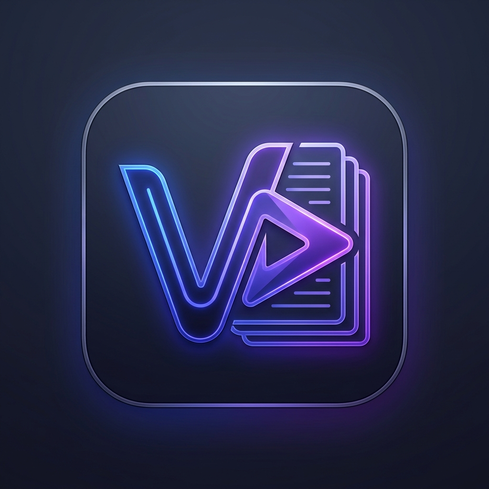

<div align="center">



# 📝 VNote — Video & AI Study Studio

**A Cross-Platform Desktop Note-Taking & Video Learning Studio powered by Electron, React, and Google Gemini AI.**

Take freeform notes, sketch diagrams, automatically sync YouTube lecture timestamps, chat with an AI copilot grounded in verbatim transcripts, and save AI responses straight into text boxes on your canvas — all with offline-first local SQLite durability.

---

### 🛠️ Built With


</div>

---

## 🌟 Key Features

### 🎥 1. Synchronized Video Learning Stream
* **Embedded YouTube Player:** Attach any YouTube video or lecture directly to a notebook page.
* **Smart Timestamp Insertion:** Click a single button or press shortcuts to insert clickable live video timestamps (e.g. `⏱️ [04:12]`) directly into your active notes.
* **Auto-Pause While Typing:** Optional focus mode that pauses the video while you type your thoughts, resuming automatically when you finish.
* **Playlist Batch Importer:** Paste an entire YouTube playlist link to automatically generate organized notebook pages for every lesson in the course.

### 🤖 2. Gemini AI Video Copilot & Study Tutor
* **Transcript-Grounded Q&A:** Automatically downloads verbatim video closed captions and provides deep contextual answers to student questions.
* **Instant Study Prompts:** Generate summaries, bulleted takeaways, code breakdowns, and test quizzes with 1-click prompt chips.
* **Full Chat Persistence:** Conversations are saved on disk per page so your chat history is preserved whenever you close and reopen the app.
* **Save Chat to Canvas Text Box:**
  * **Option A:** Save any individual AI answer directly as a dedicated text box on the canvas with 1 click.
  * **Option B:** Save the entire Q&A study conversation into an expanded markdown text box on your page.
* **Resilient Multi-Model Fallback:** Automatically cascades through active Gemini models (`gemini-3.5-flash`, `gemini-3.7-flash`, `gemini-3.6-flash`, etc.) with exponential backoff retry to handle Google server demand spikes seamlessly.

### 🎨 3. Infinite Freeform Studio Canvas
* **Drawing & Annotations:** Smooth digital drawing with Pen, Highlighter, and Eraser tools with configurable stroke sizes and an interactive HSL color wheel.
* **Dynamic Movable Text Boxes:** Create markdown-enabled text boxes anywhere on the canvas with drag-and-drop handles and auto-saving.
* **Course Outline & Keyframe Cards:** Dedicated structured cards for lesson outlines and snapshot code highlights.
* **Voice Memos:** Record audio voice notes directly on the canvas with speech-to-text transcript generation.
* **Studio Minimap & Zoom:** Real-time canvas minimap for quick navigation across large workspaces, with smooth zoom (`50%` to `200%`).

### 🖥️ 4. Native Desktop Experience (Windows, macOS, Linux)
* Standalone desktop application window powered by Electron (no browser tab clutter).
* Dedicated dark-mode application window (`#0c0f14`), auto-hidden native menu bar, and custom taskbar branding.
* Safe external link management that opens YouTube or documentation in your default browser.

### 🗄️ 5. Zero Vendor Lock-in & Local SQLite Durability
* Uses a **Master Database** (`master.db`) to track books and settings, with isolated SQLite databases per notebook (`book_[id].db`) and JSON note files.
* In desktop mode, data is automatically stored in permanent OS user paths (`%APPDATA%` on Windows, `~/Library/Application Support` on macOS, `~/.config` on Linux).

---

## 🏗️ Architecture & How It Was Created

VNote was built using a multi-tiered architecture:

```
┌────────────────────────────────────────────────────────┐
│                   VNote Desktop App                    │
│                                                        │
│  ┌──────────────────────────────────────────────────┐  │
│  │         Electron Main Process (main.js)          │  │
│  │   • Window management & single-instance lock     │  │
│  │   • Taskbar branding & external URL routing      │  │
│  │   • Embedded backend lifecycle & port selection  │  │
│  └─────────────────────────┬────────────────────────┘  │
│                            │                           │
│     ┌──────────────────────┴──────────────────────┐    │
│     ▼                                             ▼    │
│  ┌─────────────────────────┐   ┌────────────────────┐  │
│  │  Vite + React Frontend  │   │  Express Backend   │  │
│  │  • Studio Canvas & Cards│   │  • SQLite3 & JSON  │  │
│  │  • YouTube Iframe API   │◄─►│  • Youtube Engine  │  │
│  │  • ApiKey & Video Modals│   │  • Google Gemini   │  │
│  └─────────────────────────┘   └────────────────────┘  │
└────────────────────────────────────────────────────────┘
```

1. **Frontend:** React 19 single-page application built on Vite, with Lucide React icons and customized CSS design system.
2. **Backend Services:** Express 5 HTTP REST API with SQLite3 databases (`server/db/`) and modular note storage services (`server/services/`).
3. **Desktop Layer:** Electron v45 with context-isolated preload scripts (`electron/preload.cjs`), automatic local data migration, and `electron-builder` packaging.

---

## 📋 Prerequisites

Before running or building the project, ensure you have:
* **[Node.js](https://nodejs.org/)** (v18.0.0 or higher recommended)
* **npm** (v9.0.0 or higher)
* *(Optional)* A free **[Google Gemini API Key](https://aistudio.google.com/app/apikey)** (can be configured directly in the app's Profile menu).

---

## 🚀 Getting Started

### 1. Clone the Repository
```bash
git clone https://github.com/your-username/vnote.git
cd vnote
```

### 2. Install Dependencies
```bash
npm install
```

### 3. Configure Environment *(Optional)*
You can copy `.env.example` to `.env` or set your API key inside the desktop app:
```bash
cp .env.example .env
```
Inside `.env`:
```env
gemini_api_key=your_gemini_api_key_here
PORT=3001
```
*(Note: You can also open the app, click the Profile avatar in the top-right, and click **Set Gemini API Key**).*

---

## 💻 Running the Application

### Option A: Run in Desktop Development Mode (Recommended)
This runs the Express backend, Vite development server, and launches the native Electron desktop application with Hot Module Reloading (HMR):
```bash
npm run electron:dev
```

### Option B: Run in Desktop Production Preview
Builds the production bundle and runs the app using its embedded production server:
```bash
npm run electron:preview
```

### Option C: Run in Web Browser
If you want to run the project as a web application:
```bash
npm run dev
```
* Client: `http://localhost:5173`
* Backend API: `http://localhost:3001`

---

## 📦 How to Build an Executable (`.exe`)

To package VNote into a standalone installer or portable application for Windows, macOS, or Linux, run:

```bash
npm run electron:build
```

### What happens during the build:
1. Vite compiles and optimizes your React frontend into the `dist/` directory with relative desktop asset paths.
2. `electron-builder` automatically prepares native dependencies (such as `sqlite3` binaries) for Electron.
3. Packages the app into standalone installers in the **`release/`** folder:
   * **Windows:** `.exe` installer (NSIS setup) and portable executable (`release/VNote Setup 1.0.0.exe`).
   * **macOS:** `.dmg` and `.zip` packages.
   * **Linux:** `.AppImage` and `.deb` packages.

---

## ⌨️ Useful Keyboard Shortcuts

| Shortcut | Action |
| :--- | :--- |
| `Ctrl + Z` / `Cmd + Z` | Undo last canvas action or stroke |
| `Ctrl + Y` / `Cmd + Y` | Redo last action |
| `V` | Switch to **Select / Pointer** tool |
| `P` | Switch to **Pen** tool |
| `H` | Switch to **Pan / Hand** tool |
| `E` | Switch to **Eraser** tool |
| `Ctrl + =` / `Ctrl + -` | Zoom In / Zoom Out canvas |
| `Enter` (in title) | Save and commit notebook / page title |
| `Esc` | Close any active modal dialog |

---

## 📂 Project Directory Structure

```
VNote/
├── electron/
│   ├── main.js              # Electron main process (lifecycle, server, window)
│   └── preload.cjs          # Secure context bridge API
├── public/
│   ├── vnote_logo.png       # Desktop app logo & taskbar icon
│   └── favicon.svg
├── server/
│   ├── config/
│   │   └── paths.js         # Cross-platform data directory resolver
│   ├── db/
│   │   ├── masterDb.js      # Books & user settings SQLite database
│   │   └── bookDbManager.js # Per-notebook SQLite database manager
│   ├── services/
│   │   └── noteFileService.js # File storage for canvas notes and chats
│   └── index.js             # Express API server & Gemini integration
├── src/
│   ├── components/
│   │   ├── ApiKeyModal.jsx         # Gemini API key configuration modal
│   │   ├── StudioCanvas.jsx        # Freeform interactive drawing & note canvas
│   │   ├── StudioHeader.jsx        # Navigation, tools, and profile header
│   │   ├── UnifiedSidebar.jsx      # Notebook tree & playlist manager
│   │   ├── VideoAiChatWindow.jsx   # Gemini Video Copilot with chat saving
│   │   ├── VideoModal.jsx          # YouTube URL attachment modal
│   │   └── StudioCards/            # Video stream, voice memo, code cards
│   ├── services/
│   │   └── api.js                  # Frontend API client
│   ├── App.jsx                     # Top-level workspace layout & state
│   └── App.css                     # Comprehensive studio design system
├── package.json
└── vite.config.js
```

---

## 📄 License

This project is licensed under the MIT License — see the [LICENSE](LICENSE) file for details.
